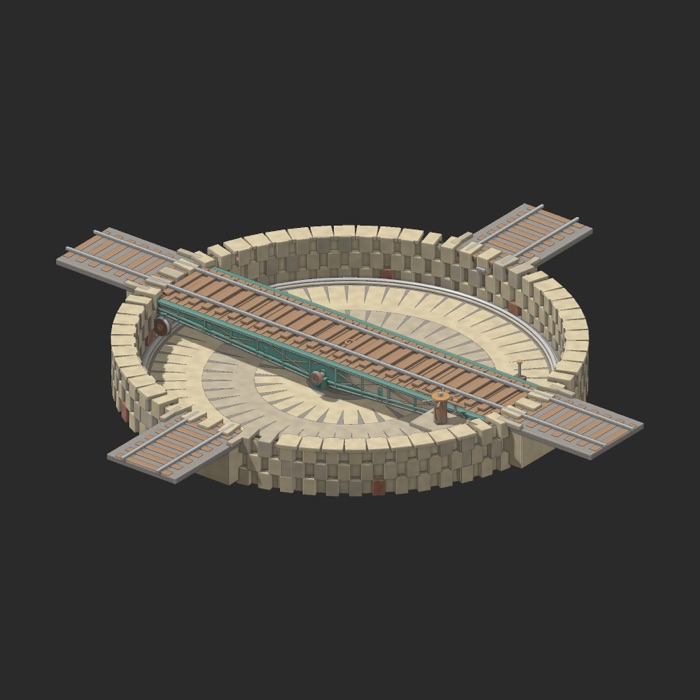
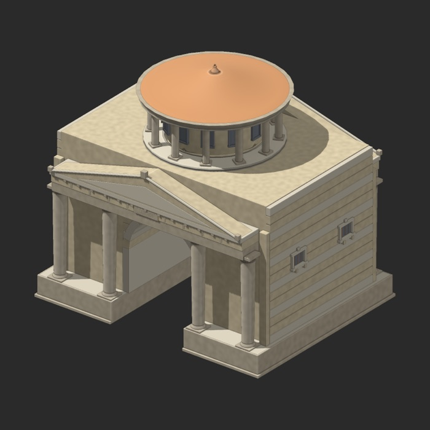
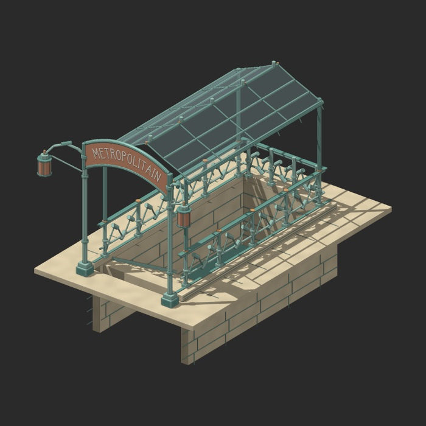
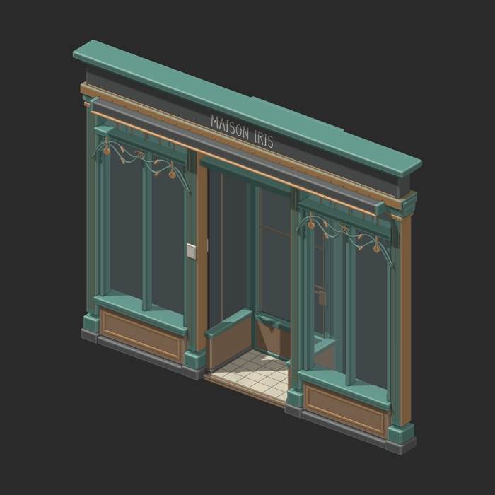
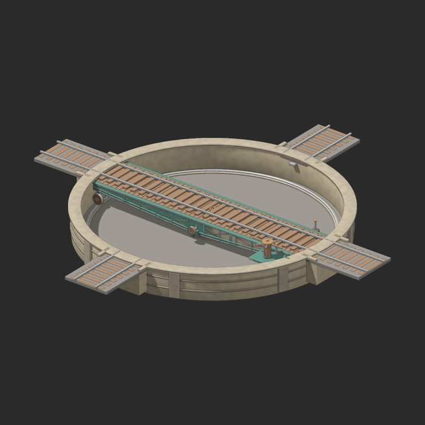

# procgen-hy4

A procedural 3D kit modeler that a cheap model can drive. A language model writes a short Python **kit
builder**. A C++20 core (`pgm`) turns it into a parametric geometry graph, then checks it: closed manifold
meshes, every control swept to its limits, parts that touch, MuJoCo/CoACD collision. It also renders it. The
harness around it lets **Hy4 Flash** (`tencent/hy4-flash`) build kits that hold up against frontier models
at about a tenth of the cost.

Agents: start with [AGENTS.md](AGENTS.md).

## Quick start

Run every command from the repository root.

```bash
git clone https://github.com/wrong-nebula/procgen-hy4.git
cd procgen-hy4
(cd procgen && cmake --preset release && cmake --build --preset release -j 8)
```

Render a kit Hy4 Flash built (the generated documents are in the repo, so no Python is needed):

```bash
procgen/build-release/pgm render examples/hy4/out/turntable/turntable.json --out /tmp/turntable.png --view iso
```

Views: `iso`, `opposite`, `front`, `side`, `top`. Passes: `--pass beauty` (default), `clay`, `parts`.
`--set name=value` changes a control, e.g. `--set diameter=20`.

Build your own kit: copy the starter, run it, check it.

```bash
python3 examples/starter/bollard.py
(cd procgen && python3 tools/kit_harness/verify_round.py --script ../examples/starter/bollard.py \
  --doc ../examples/starter/out/bollard/bollard.json --render /tmp/bollard.png --stamp /tmp/bollard.ok)
```

It prints `ALL GATES PASS | tris=216 | ... | MuJoCo=100/100 ...` when every gate passes.

## Hy4 Flash results

Each kit below was written by Hy4 Flash, then judged blind against a frontier model's build of the same brief.
Numbers are from [`examples/hy4/results.json`](examples/hy4/results.json) (runs of 2026-11-21).

| Kit | Hy4 build | Frontier rival | Judges preferred Hy4 | Hy4 cost | Frontier cost |
|---|---|---|---|---|---|
| Railway turntable |  | gpt-6.1-terra (high) | **yes**, p = 0.71 | $0.048 | $0.486 |
| City gate |  | gpt-6.1-terra (high) | **yes**, p = 0.68 | $0.057 | $0.434 |
| Metro entrance |  | gpt-6.1-sol | no, p = 0.19 | $0.044 | $0.764 |
| Iron shopfront |  | gpt-6.1-sol | no, p = 0.19 | $0.045 | $0.619 |

All four pass `pgm check`, `pgm sweep` and `pgm audit --sweep`. None passes the stricter kit_harness
gate (`check --intersections`): solids of one material overlap inside the merged material leaf. That gate
was added after these runs.

Rebuild a document from Hy4's builder:

```bash
python3 examples/hy4/turntable.py                       # -> examples/hy4/out/turntable/turntable.json
```

### Turntable `wall` control

The turntable has one control added after the Hy4 run:

- `wall=0` (default): Hy4's block-built pit (192 wall blocks, 64 coping stones, 132 floor flags),
  geometrically identical to Hy4's build. 101,276 triangles.
- `wall=1`: one turned wall ring, one coping ring and a plain floor. 56,764 triangles.

```bash
procgen/build-release/pgm render examples/hy4/out/turntable/turntable.json --set wall=1 --out /tmp/turntable.png --view iso
```



Both settings pass `check`, `sweep` and `audit --sweep`.

## How it works

1. **Parametric build.** The model writes a builder on `kitlib` (Z-up, metres): a datum table, then five
   functions (base, primary mass, openings or mechanism, secondary craft, details). Primitives include
   lathe, curve + tube, loft, sweep, booleans, bevel, Chaikin subdivision with exact limit positions, and
   surface details (rivets, bolts, seams, lettering) stored as data on a clean mesh.
2. **Procgen gates.** `pgm check` (closed, manifold, oriented), `pgm sweep` (defaults plus min and max of every
   control), `pgm audit` (contact graph within 3 mm, no detached parts).
3. **Physical and visual diagnostics.** `procgen/tools/kit_harness`: MuJoCo + CoACD overlap X-ray, a free-spin
   test for mechanisms, a 2x2 diagnostic sheet with axes and a human figure, DepthPro2-S metric depth and normal
   sheets, visual-hull carving for missing silhouettes, and a vision critic that returns at most 7 ranked misfits.
4. **One fail-fast command.** `verify_round.py` runs every gate and prints at most 8 lines, writing a stamp file
   only when all pass. A small model's context stays small, and it cannot claim a pass it did not get.
5. **Evolution loop.** `bench/harness/kit_evolve.py` seeds builders with Hy4, refines the function holding the
   worst defect, tunes proportions with CMA-ES (no LLM calls) and keeps the best per behaviour cell.
   `verify_optimizer.py showdown` judges the winner against a frontier build.

## Subdivision surfaces (SDS)

`pgm` has its own Catmull–Clark subdivision (no external library):

- semi-sharp creases on edges and vertices, and Chaikin blending between crease weights;
- `limit=1` snaps points onto the exact limit surface, so a subdivided part does not shrink and keeps its
  3 mm contacts and port positions; `limit_normals=1` gives exact smooth normals;
- `lodLevels=[2, 1, 0]` writes levels of detail.

In a builder: `g.subdivide(id, src, levels=2, creaseMethod="chaikin", limit=1, limit_normals=1)`, or the
ready parts `sds_cylinder` and `cast_housing` in `procgen/recipes/kitparts.py`. `pgm check` reports how
SDS-ready each mesh is (quad ratio, creased edges, high-valence poles, pinched poles).
The Hy4 builds use SDS for cast pieces (king-pin housing, drums, collars, capitals) and bevelled flat
faces for machined and stone parts.

## Layout

| Path | What |
|---|---|
| `procgen/` | C++20 core (`pgm`, mesh ops, document evaluator, tests) and the Python kit DSL in `procgen/recipes/` |
| `procgen/recipes/greenhouse/` | A generated kit family (iron-and-glass greenhouse), used by the tests |
| `procgen/tools/kit_harness/` | Verification and diagnostic tools, see its [README](procgen/tools/kit_harness/README.md) |
| `bench/harness/` | Hy4 Flash evolution loop, judges and showdown |
| `bench/tasks/` | 28 modelling briefs with controls, ports and materials |
| `examples/starter/` | Smallest builder that passes every gate |
| `examples/hy4/` | The four Hy4 Flash builds above, their documents and results |

## Requirements

- CMake 3.24+, a C++20 compiler (clang on macOS, gcc 12+ on Linux), Python 3.10+, `numpy`, `pillow`.
- MuJoCo gates: [`uv`](https://docs.astral.sh/uv/) (installs `mujoco` and `coacd` per run).
- DepthPro2-S and DINOv2 tools: `torch`. Their model weights are downloaded from their publishers under
  their own licences. They are not included here.
- Evolution loop: an [OpenRouter](https://openrouter.ai) key in `PGBENCH_OPENROUTER_KEY` or
  `~/.config/pgbench/openrouter.key`. The showdown also needs frontier baseline builds, which are not shipped.

## Tests

```bash
procgen/build-release/pg_tests                         # 145 C++ tests, from the repository root
for t in procgen/recipes/test_*.py procgen/tools/test_*.py; do python3 "$t" || break; done
```

## Licence

MIT, see [LICENSE](LICENSE). `procgen/third_party/geogram_psm` is BSD-3-Clause (Inria), see its LICENSE.
